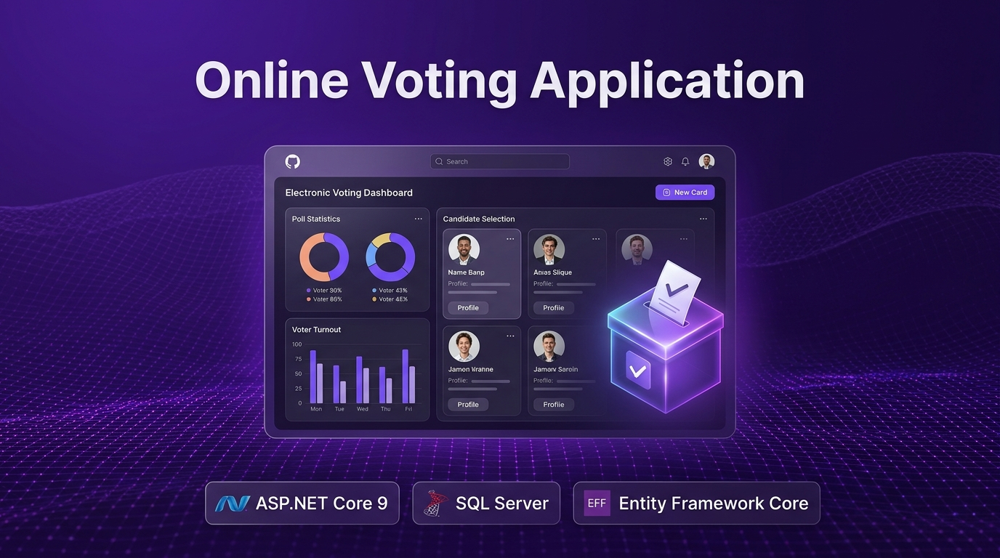
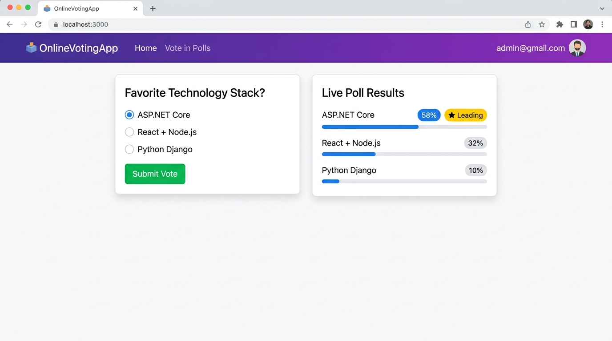
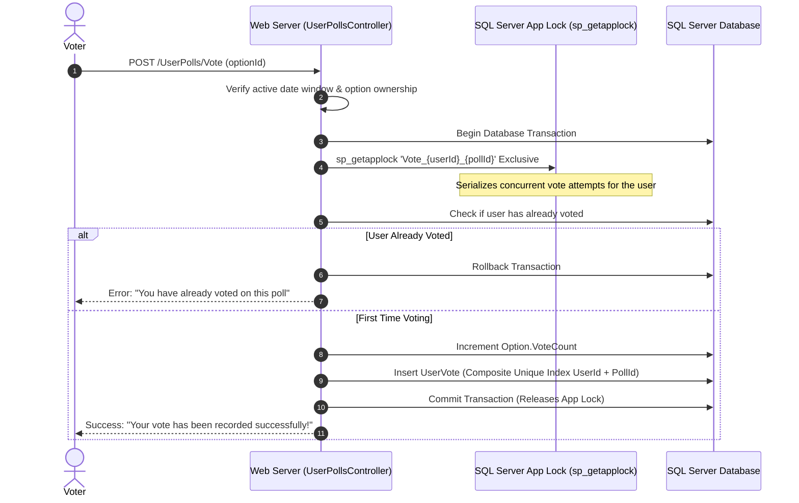

<p align="center">
  
</p>

# Online Voting Application

<p align="center">
  
  
  
  
  
  
  
</p>

A robust, enterprise-grade web application for creating, administering, and conducting secure online elections and polls, built with **ASP.NET Core 9.0 MVC**, **Entity Framework Core**, and **Microsoft SQL Server**.

---

## 📸 Application Previews

<p align="center">
  
  <br/>
  <em>Live Voting Interface with Dynamic Results, Percentage Distribution & Leading Candidate Badges</em>
</p>

---

## Features

### 🗳️ Voting Engine & Concurrency Security
* **Concurrency-Safe Voting:** Enforces exclusive transaction-level locks (`sp_getapplock`) in SQL Server and database-level composite unique constraints on `(UserId, PollId)` to eliminate duplicate voting and submission race conditions.
* **Poll Window Validation:** Enforces scheduled start and end dates (`FromDate` &mdash; `ToDate`); votes cast outside the active window are automatically rejected.
* **Option Ownership Verification:** Validates that submitted choices strictly belong to the targeted poll before recording votes.

### 🛡️ Authentication & Authorization
* **Role-Based Access Control:** Dedicated navigation, dashboards, and capabilities for **Administrators** and regular **Voters**.
* **Anti-Brute-Force Account Lockout:** Automatically locks accounts for 15 minutes after 5 consecutive failed login attempts.
* **CSRF Protection:** Anti-forgery validation tokens applied across all state-changing `POST` actions.
* **Self-Deletion Guard:** Administrators are prevented from deleting their own active accounts.
* **Default Seeding:** Pre-configures initial administrative access (`admin@gmail.com`) on startup.

### 📊 Poll Management & Results
* **Dynamic Options:** Add and remove answer choices on the fly during poll creation and editing with automatic client-side index synchronization.
* **Vote History Safeguard:** Answer options with recorded votes cannot be deleted during edits, guaranteeing complete audit integrity. Unvoted options can be removed safely.
* **Live Results Dashboard:** Real-time vote counts, percentages, progress bars, tie detection (`⭐ Leading` badge), and division-by-zero protection for new polls.
* **Optimized Aggregation:** Server-side SQL grouping and aggregation ensures $O(1)$ web server memory consumption even under high voter volume.

### 🧪 Automated Test Suite
* Built with **xUnit** and **EF Core In-Memory**, covering date range logic, active poll windows, option ownership, duplicate vote prevention, and option removal policies without mutating the primary database.

---

## 🔄 Concurrency Architecture

The application uses a defense-in-depth architecture to ensure vote idempotency and prevent double-voting under concurrent requests:



---

## Tech Stack

* **Framework:** ASP.NET Core 9.0 (MVC + Razor Pages)
* **ORM:** Entity Framework Core 9.0
* **Database:** Microsoft SQL Server (or SQL Server Express)
* **Authentication:** ASP.NET Core Identity
* **Testing:** xUnit, Microsoft.EntityFrameworkCore.InMemory
* **Frontend:** Bootstrap 5, Modern CSS Gradient Theme

---

## Project Structure

```text
OnlineVotingApp/
├── docs/
│   └── images/                     # Screenshots & Hero Banner Assets
├── OnlineVotingApp/                # Main Web Application
│   ├── Areas/Identity/             # Authentication & Account Pages
│   ├── Controllers/                # MVC Controllers (Admin, AdminPolls, UserPolls, Home)
│   ├── Data/                       # ApplicationDbContext & EF Core Migrations
│   ├── Models/                     # Domain Entities (Poll, AnswerOption, UserVote)
│   ├── Views/                      # Razor Views & Layouts
│   └── wwwroot/                    # Static Assets (CSS, JS, Libraries)
├── OnlineVotingApp.Tests/          # Automated Test Suite (xUnit + EF Core InMemory)
└── OnlineVotingApp.sln             # Solution File
```

---

## Getting Started

### Prerequisites
* [.NET 9.0 SDK](https://dotnet.microsoft.com/download/dotnet/9.0)
* [SQL Server](https://www.microsoft.com/sql-server/sql-server-downloads) (Developer, Standard, or Express Edition)
* [Git](https://git-scm.com/)

### 1. Clone the Repository
```bash
git clone https://github.com/Adelhaneef/OnlineVotingApp-demo.git
cd OnlineVotingApp-demo
```

### 2. Configure Database Connection
Update the connection string in `OnlineVotingApp/appsettings.json` if your SQL Server instance name differs:

```json
{
  "ConnectionStrings": {
    "VotingApp": "Server=localhost\\SQLEXPRESS;Database=VotingDb;Trusted_Connection=True;MultipleActiveResultSets=true;TrustServerCertificate=True"
  }
}
```

### 3. Apply Migrations
Open terminal in the `OnlineVotingApp` project directory and run:
```bash
cd OnlineVotingApp
dotnet ef database update
```

### 4. Run the Application
```bash
dotnet run
```
Open your browser and navigate to `http://localhost:5030` (or `https://localhost:7030`).

### 5. Default Administrator Login
On initial launch, a default administrator account is seeded:
* **Email:** `admin@gmail.com`
* **Password:** `Admin@12345`

---

## Running Automated Tests

To execute the test suite:
```bash
dotnet test OnlineVotingApp.Tests/OnlineVotingApp.Tests.csproj
```

---

## License
This project is open-source and available under the [MIT License](LICENSE).
